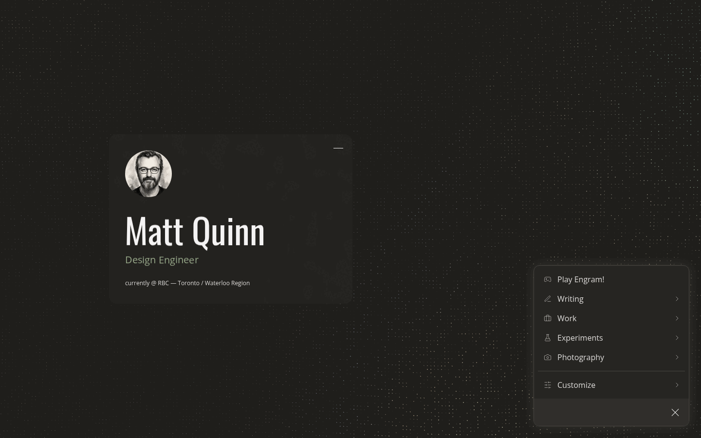
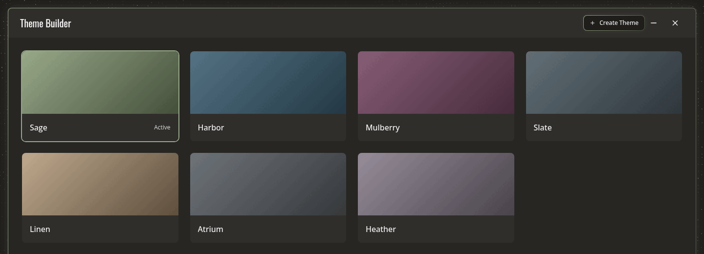
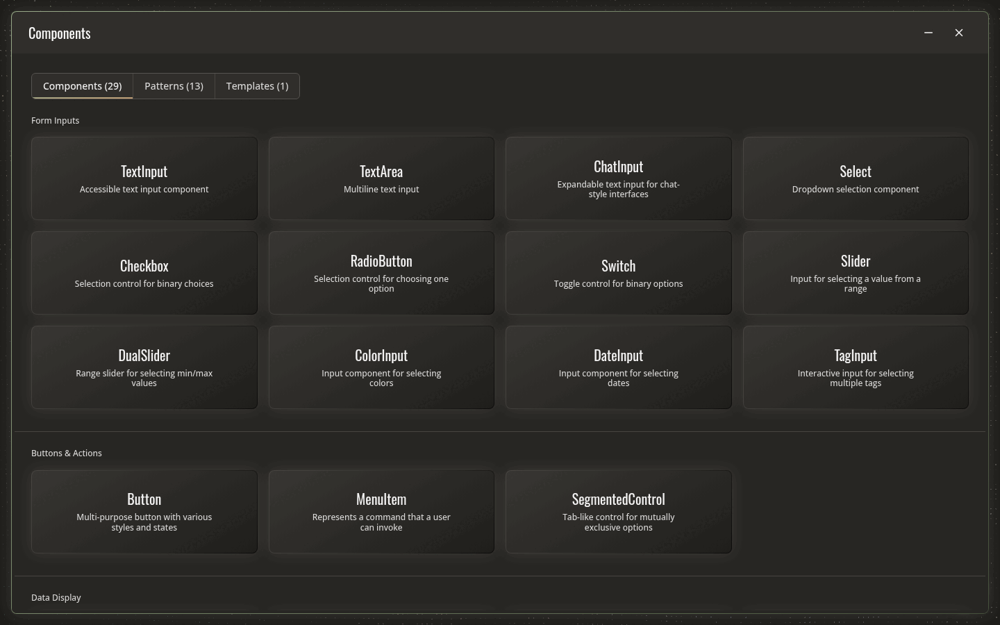

# levain DS

[](https://github.com/iammattq/levain-ds/actions/workflows/ci.yml)

levain DS is the design system behind [mattquinn.ca](https://mattquinn.ca): a set of design tokens generated from a few colour choices, and the React components and patterns built on them. It began inside that portfolio and now stands on its own, so other projects can grow from the same base.

A *levain* is a baker's starter: the living culture every loaf is grown from, fed and kept going rather than rebuilt each time. That is the job of this repository.







## The ideas behind it

**Themes are generated, not hand-picked.** A theme is a name, a primary colour and an accent colour, plus a few optional dials. The generator works in OKLCH, a colour space where equal steps in lightness look equal, and produces from that input:
- a 26-stop neutral surface ramp, lightly tinted with the brand hue;
- 9-stop ramps for primary and accent;
- success, error and other action colours, with their interaction states;
- a small spectrum for charts and accents;
- all of it for light mode and for dark.

Text colours are chosen against their backgrounds by WCAG contrast. The seven built-in themes (Sage, Harbor, Mulberry, Slate, Linen, Atrium, Heather) are all outputs of that one function, and the theme builder on mattquinn.ca lets anyone make more.

**Tokens are the single source.** Components never name a colour. They use semantic tokens (`--color-surface-card`, `--color-text-muted`, `--space-md`, `--radius-lg`), and each theme maps those tokens to stops on its ramps. The mapping holds two rules, in both modes, and tests enforce them: each layer that sits on another (canvas, section, card, component, elevated) is higher on the ramp, never on the same rung, so every boundary has a tonal step; and borders stay off the ladder, so a border never matches a surface it can sit on. The same theme data is also emitted as Kotlin (a Material 3 `ColorScheme`) for Android. Typography works the same way: ten presets, each a font pairing mapped onto one semantic type scale.

**Rules written down, for people and for tools.** `packages/ui-react/docs/assembly.json` holds 17 invariants and 49 recipes in plain language, each with why it exists and how to check it. Some examples:
- the space inside an element never exceeds the space around it;
- a heading sits closer to what it introduces than to what came before;
- each boundary between layers gets one dominant signal: a surface step, a border or a shadow, never all three.

`hierarchy.json` is the reference beside it: the surface ladder, the spacing scale and the radius formula. Both are JSON so a reviewer, human or AI, can check a change against the rules rather than against taste.

**Three layers.**
- **Components** are the atoms: Button, TextInput, Card.
- **Patterns** compose them into recognisable pieces: navigation, media cards, the theme toggle.
- **Templates** lay out whole pages.

Each layer owns its own spacing, so a page that composes them reads as designed rather than assembled.

**Motion is part of the system, not decoration.** It comes from the OS shell on mattquinn.ca (its menu, windows and dock), and its first rule is that shapes morph into each other rather than swap:
- a button grows into its menu, a card into its dialog and back; one element changes geometry, and its content fades in once there is room;
- bigger things take longer: feedback 150 ms, a small morph 460 ms, a window arriving 620 ms;
- arrivals ride a sampled spring that overshoots a little and settles (a cubic-bézier can't); departures are quicker and plain;
- a drag tracks the pointer exactly; the card lifts one elevation step, leans with its speed, and settles into its slot on the spring.

The durations, curves and stagger are tokens, in CSS (`--duration-morph`, `--ease-spring`, `--stagger`) and as framer-motion recipes (`recipe.morph`), and `prefers-reduced-motion` turns every one into an instant change. `assembly.json` states ten motion rules the same way as the spacing ones, and tests check the mechanical ones over every component.

**Density is a mode.** `data-density="condensed"`, on the page or any part of it, moves the spacing, radius and body type scales one step tighter, in order, so every spacing rule still holds and nothing needs a second set of tokens.

**No framework lock-in.** The components don't import Next.js or any router. An app hands levain what only it knows through one provider, `LevainProvider`:
- its link component;
- its image component;
- the current path, for active navigation;
- its theme state.

Without the provider, links are plain `<a>` and images plain ``.

## What's in it

Two packages, released together under the same version:

| Package | What it holds |
|---|---|
| `@levain/tokens` | The OKLCH theme generator, the theme manager that applies a theme at runtime, the built-in themes and typography presets, and `shared.css` (the spacing, type and radius scales as Tailwind 4 theme values and CSS variables). |
| `@levain/ui-react` | The React components, patterns and templates, and `LevainProvider`. TypeScript source, no build step: your bundler compiles it. |

| Layer | |
|---|---|
| Components (forms) | TextInput, TextArea, ChatInput, Select, Checkbox, RadioButton, Switch, Slider, DualSlider, ColorInput, ColorPickerPanel, GradientInput, DateInput, Calendar, TagInput, EditableText |
| Components (actions and navigation) | Button, TextLink, MenuItem, SegmentedControl, Tabs, SectionTabs, Pagination, Accordion, SortableList (drag and drop within and across lists: mouse, touch, keyboard) |
| Components (display) | Card (with CardContent, CardMedia, CardTitle), Section, Heading, Tag, Avatar, ImageWithLoadState, DataTable, Loader, Modal, Toaster |
| Patterns | StatusCard and StatusCardDialog (a compact card with status markers that grows into its own dialog), SurfaceCard, GradientCard, MediaCard, ImageUploader, ConfirmationModal, NavigationLinks, EditorialNavigation, ContentNavigation, PillNavigation, Footer, Timeline, ThemeToggle, ThemeSwitcher, ThemeColorButton, TokenSelect, GradientEditor, ToolSidebar, ToolInfo, AsciiHeader, SimpleAnimatedName, DotMatrixReveal |
| Templates | PageTemplate, AdminPageTemplate |

Tests: 496 for tokens (the generator, contrast, ramps, the token mapping's rules, motion and density), 794 for the components, including the motion rules checked over every component (Jest and Testing Library). Run them with `pnpm install && pnpm test`; `pnpm check:types` type-checks both packages, and `pnpm build` builds `smoke/` (a small Vite app that imports every export through Tailwind 4, as a consumer would) and `demo/`. CI runs all three on every push to main and every pull request. `pnpm --filter @levain/demo dev` serves the demo: every motion recipe, the density modes, and drag and drop.

What's missing so far, from real use, is kept in [docs/GAPS.md](docs/GAPS.md).

## Using it

**Install** from a tag. List both packages, pinned to the **same** tag (ui-react takes tokens as a peer dependency at its exact version, so pnpm warns if they drift):

```json
"@levain/tokens": "git+https://github.com/iammattq/levain-ds.git#v0.1.0&path:packages/tokens",
"@levain/ui-react": "git+https://github.com/iammattq/levain-ds.git#v0.1.0&path:packages/ui-react"
```

Its peer dependencies are React 18 or 19, Tailwind CSS 4, lucide-react, framer-motion, sonner, @tanstack/react-table and react-dropzone.

**Tailwind 4.** In your global stylesheet, point Tailwind at the components' source and bring in the shared scales:

```css
@import 'tailwindcss';
@source '../node_modules/@levain/ui-react/src/**/*.{ts,tsx}';
@import '@levain/tokens/src/styles/shared.css';
@custom-variant dark (&:where(.dark, .dark *));
```

**Compile the source.** In Next.js, `transpilePackages: ['@levain/tokens', '@levain/ui-react']`. Vite compiles it as is.

**The provider.** In Next.js, from a client component near the root:

```tsx
'use client';
import Image from 'next/image';
import Link from 'next/link';
import { usePathname } from 'next/navigation';
import { LevainProvider } from '@levain/ui-react';
import { useMyTheme } from './theme';

export function Providers({ children }: { children: React.ReactNode }) {
  return (
    <LevainProvider linkComponent={Link} imageComponent={Image} usePathname={usePathname} useTheme={useMyTheme}>
      {children}
    </LevainProvider>
  );
}
```

`useTheme` is needed only by the theme patterns (ThemeToggle, ThemeColorButton, SimpleAnimatedName). It returns `{ theme, setTheme, themeIndex, setThemeIndex, saveThemePreference }`.

**Start the theme, in this order.** Dark mode is a class on `<html>`, and the components' `dark:` styles follow that class, not the colour values. So set the mode first, then apply the theme:

```ts
import { initTheme, themeManager } from '@levain/tokens';

initTheme(); // puts .dark on <html> from the saved mode (dark by default)
themeManager.applyTheme(0); // writes theme 0's tokens for that mode
```

Done the other way round, the colours come out dark while cards keep their light styling. In a server-rendered app, also set the class in an inline script before paint, as mattquinn.ca does, so the first frame is already in the right mode.

**Motion.** In CSS, time transitions with the tokens: `transition: width var(--duration-morph) var(--ease-spring)`. In framer-motion, pass a recipe through `motion()`, which reads reduced motion for you:

```tsx
import { motion as motionFor } from '@levain/tokens';
import { motion, useReducedMotion } from 'framer-motion';

const reduce = useReducedMotion();
<motion.div layout transition={motionFor('shift', reduce)} />;
```

**Drag and drop.** Wrap the lists in one `SortableGroup` and apply each move yourself:

```tsx
<SortableGroup onMove={({ key, from, to, index }) => move(key, from, to, index)}>
  <SortableList id="todo" label="To do" items={todo} getKey={t => t.id} renderItem={t => <StatusCard id={t.id} title={t.text} />} />
  <SortableList id="queued" label="Queued" items={queued} getKey={t => t.id} renderItem={t => <StatusCard id={t.id} title={t.text} />} />
</SortableGroup>
```

**Making themes.** Add an entry to `packages/tokens/src/data/baseThemesV2.ts` and run `pnpm --filter @levain/tokens generate-themes`. That rewrites `generated/` (the theme JSON and the Kotlin output).

## Built with

TypeScript, React, Tailwind CSS 4, [culori](https://culorijs.org) for the colour science, class-variance-authority and tailwind-merge for variants, Jest and Testing Library.

## Licence and credits

MIT (see [LICENSE](LICENSE)), with two exceptions for type data made by others:

- **DotMatrix5x7** by felias-fogg, [github.com/felias-fogg/DotMatrix5x7](https://github.com/felias-fogg/DotMatrix5x7): the 5×7 dot-matrix glyphs DotMatrixReveal draws. They live in their own file, `packages/ui-react/src/patterns/dotMatrix5x7.ts`, which is licensed under the LGPL-3.0 ([LICENSES/LGPL-3.0.txt](LICENSES/LGPL-3.0.txt), with [LICENSES/GPL-3.0.txt](LICENSES/GPL-3.0.txt)). You can swap that file for your own glyphs of the same shape.
- **Pagga** by Sam Hocevar, a toilet font: the block letters AsciiHeader draws, in `packages/ui-react/src/utils/pagga.ts`, under the WTFPL ([LICENSES/WTFPL.txt](LICENSES/WTFPL.txt)).
